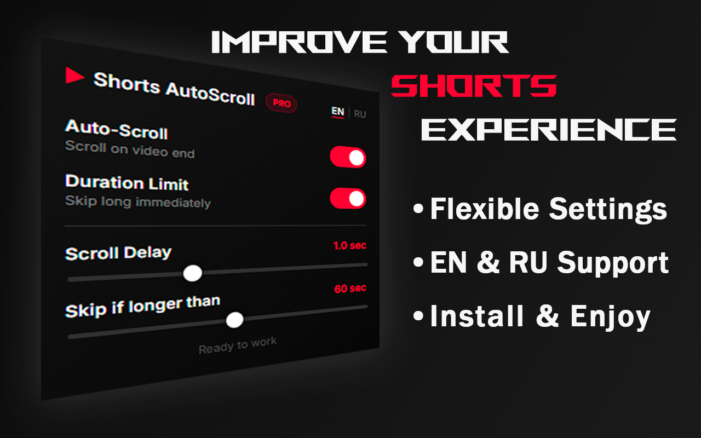
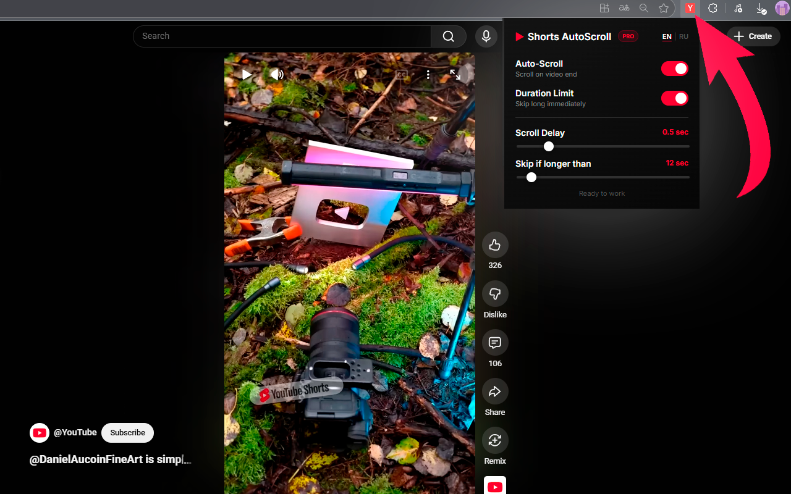

# Youtube Shorts AutoScroll

[](https://chromewebstore.google.com/detail/cfalfdakejchchmgepmoloojdclhcmif?utm_source=item-share-cb)

<p align="center">
  <a href="https://raw.githubusercontent.com/MD-KpRk/yt-auto-scroll/main/assets/screenshots/scr1.png">
    
  </a>
  &nbsp;&nbsp;&nbsp;&nbsp;
  <a href="https://raw.githubusercontent.com/MD-KpRk/yt-auto-scroll/main/assets/screenshots/scr2.png">
    
  </a>
</p>

YouTube Shorts AutoScroll is a completely free browser extension that automatically scrolls through YouTube Shorts videos.

At any time, you can click the extension icon to enable or disable the following features:
- Automatically scroll to the next video when the current one ends
- Automatically skip videos longer than a specified duration
- Automatically skip advertising Shorts detected in the page

Auto-Scroll is the master switch. Changing it in the popup or above Like updates every YouTube tab. Turning it off stops all automatic transitions and preserves the skip preferences.
When upgrading, the ad switch preserves the previous auto-scroll enabled/disabled state.
You can also set a delay before scrolling to the next video and choose the maximum video length you want to watch before it gets skipped.

The duration limit refers to the total video length, not the time spent watching.
During the countdown, use “Continue watching” or “Watch again” to cancel the transition.
Manual scrolling cancels pending transitions and blocks automation for two seconds.
Returning manually to a previously visited Short blocks all automatic transitions for that visit,
including duration/ad skips and video-end scrolling. If you seek back into the video, it can advance
again when playback reaches the end. Seeking itself does not advance the feed.
Automation pauses in hidden tabs. Failed transitions stop after three attempts for that video
until the page is reloaded. Ad detection depends on YouTube's page markup; this is not a network ad blocker.

🌏 The extension interface is available in two languages: Russian and English.

Installation instructions:
- Install the extension in your browser
- Continue in your open YouTube tab or go to YouTube Shorts

🔒 Privacy Focused. Youtube Shorts AutoScroll works entirely locally on your device. We do not collect, store, or send any user data to external servers.

## Development

Load this folder as an unpacked extension, then reload the YouTube tab after updating it.
No build step or third-party runtime dependencies are required.

- `scripts/settings.js`: shared defaults, validation and translations.
- `scripts/youtube.js`: YouTube selectors, active video and next-video navigation.
- `scripts/overlay.js`: accessible countdown controls.
- `scripts/content.js`: playback lifecycle, cancellation and bounded retries.
- `scripts/background.js`: toolbar icons reflecting URL and enabled features.
- `popup/`: master switch and skip preferences.

Run regression tests with Node.js 20 or newer:

```sh
npm test
```

The tests simulate media events, navigation and timers. Before a release, also verify
on live YouTube: direct and SPA entry to Shorts, natural end, manual seeking/scrolling,
advertising Shorts, both languages, keyboard controls, and settings changes during a countdown.
